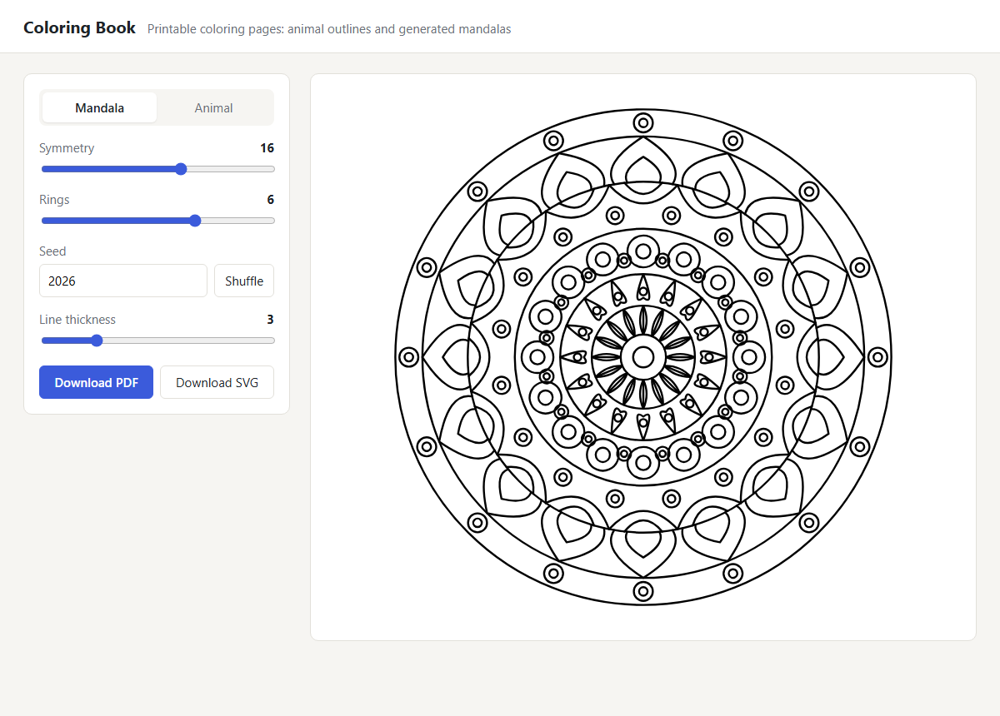
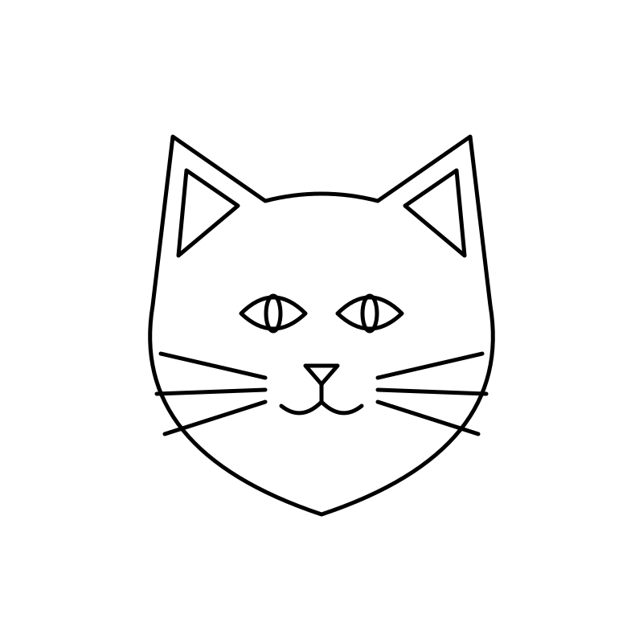
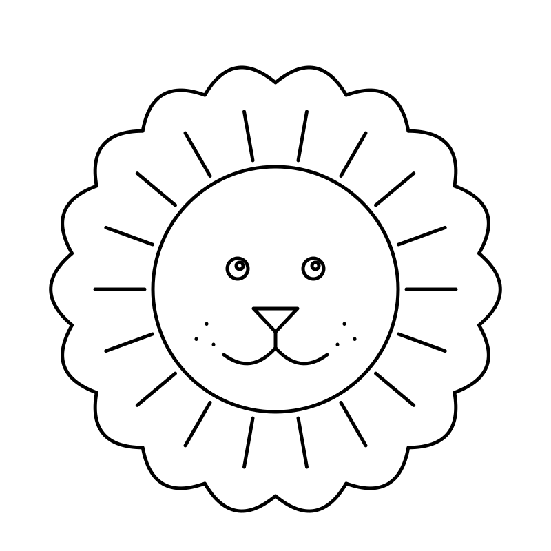
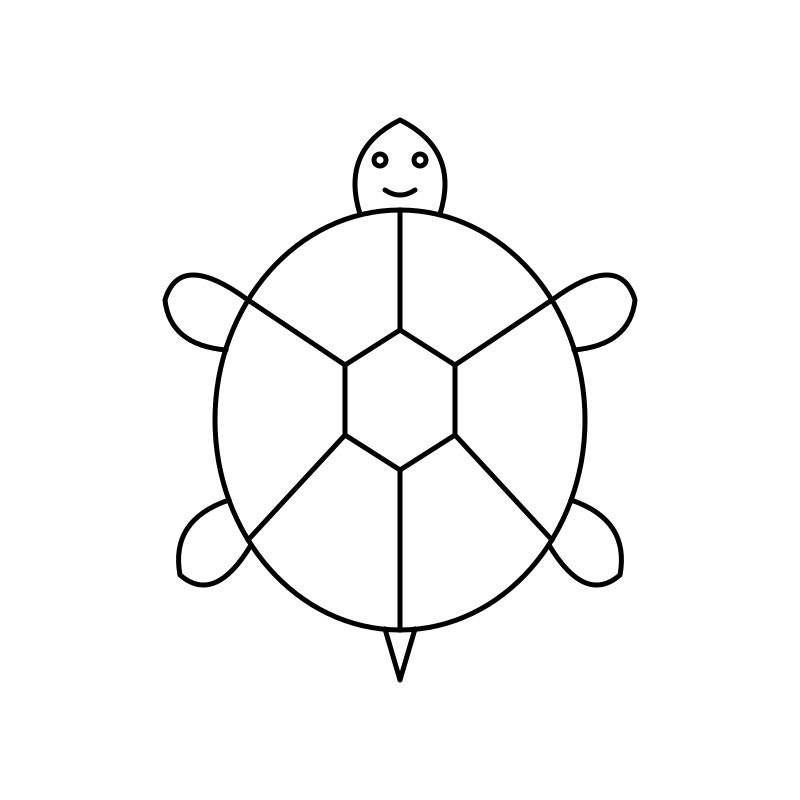

# Coloring Book

[](https://github.com/OlgaAntonikova/coloringbook/actions/workflows/ci.yml)
[](LICENSE)

A web app that makes printable coloring pages. You can generate a **mandala** from a few parameters or pick an **animal** outline, see a live preview, and download it as a vector **PDF** (A4) or **SVG**.



## Gallery

| Mandala 12 × 5, seed 7 | Mandala 8 × 4, seed 42 | Mandala 16 × 6, seed 2026 |
|---|---|---|
|  |  |  |

| Cat | Lion | Turtle |
|---|---|---|
|  |  |  |

## Features

- **Mandala generator**: concentric rings, each filled with one motif (petals, scallops, teeth, beads, leaves, drops) repeated around the center, sometimes with a smaller inner copy or a second layer between the motifs
  - symmetry 4–24, rings 2–8, line thickness 1–10
  - **deterministic**: the same seed and settings always give the same page, so a page can be shared by its numbers
- **Animal outlines**: seven hand-drawn faces, restyled to the chosen line thickness, with an optional name label
- **Live preview** that refreshes as you move the sliders
- **Vector PDF**: QuestPDF draws the SVG paths directly, so lines stay sharp at any print size and a page is a few kilobytes
- **Clear errors**: invalid input gets `400` with the reason

## Tech stack

| Area | Technology |
|---|---|
| Backend | ASP.NET Core 8 minimal APIs, Serilog, Swagger (development) |
| Frontend | Blazor WebAssembly, hosted by the API (one process, one origin) |
| Rendering | SVG built with LINQ to XML; PDF with QuestPDF |
| Tests | xUnit + `WebApplicationFactory` (unit and HTTP-level tests) |
| Delivery | Docker image, GitHub Actions (build, test, image smoke test) |

## Architecture

```text
src/ColoringBook.Api        Minimal API + host for the Blazor client
  Services/MandalaGenerator      seeded procedural mandala → SVG
  Services/SvgOutlineGenerator   animal preset → restyled SVG
  Services/ColoringPageBuilder   request → SVG (validation lives here)
  Services/QuestPdfExporter      SVG → vector A4 PDF
  Storage/LocalFileStorage       generated files; only generated names can be read back
  Presets/Animals/*.svg          animal outlines
src/ColoringBook.Web        Blazor WebAssembly UI
src/ColoringBook.Contracts  request/response records shared by API and UI
tests/ColoringBook.Api.Tests
```

## API

| Method | Endpoint | Description |
|---|---|---|
| `GET` | `/presets` | Available animals |
| `POST` | `/preview` | SVG of a page, nothing stored; the seed comes back in `X-Seed` |
| `POST` | `/generate` | Creates a PDF or SVG file and returns its URL and seed |
| `GET` | `/files/{id}.{pdf\|svg}` | Downloads a generated file |
| `GET` | `/health` | Health check |

Example:

```json
POST /generate
{ "kind": "mandala", "symmetry": 12, "rings": 5, "seed": 42, "lineThickness": 3, "format": "pdf" }
```

## Running

**With .NET 8 SDK**

```bash
dotnet run --project src/ColoringBook.Api
```

Open the URL printed in the console. Swagger is at `/swagger` in development.

**With Docker**

```bash
docker build -t coloringbook .
docker run -p 8080:8080 coloringbook
```

Open http://localhost:8080. Generated files go to the `/data` volume.

## Tests

```bash
dotnet test ColoringBook.sln
```

What the tests cover:
- mandala determinism, structure and validation;
- every animal preset;
- PDF format: one A4 page with no embedded raster images;
- the preview endpoint, `400` responses;
- a regression test for a path traversal in file downloads that was fixed.

## License

[MIT](LICENSE)
